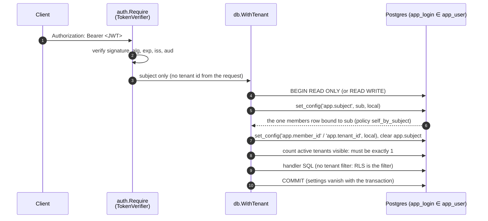
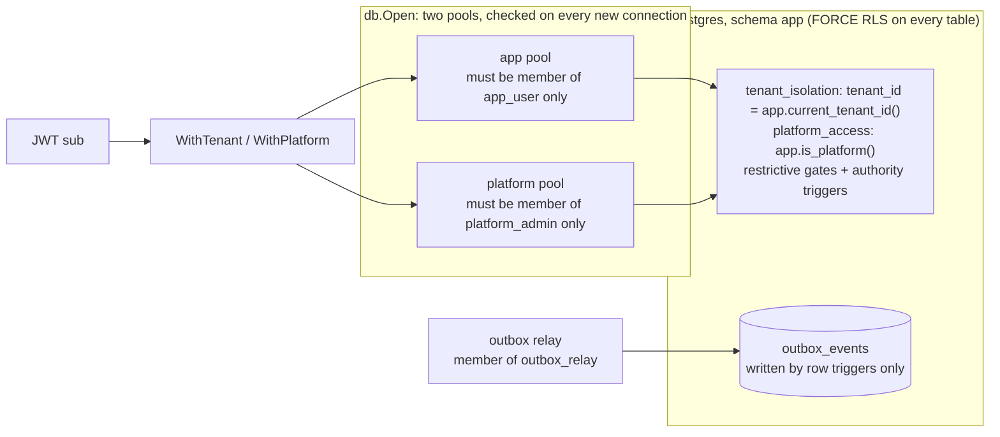

# tenant-rls

Multi-tenant isolation that lives in Postgres, not in your `WHERE` clauses: a
Go request layer that resolves the caller's tenant inside each transaction and
binds it for row-level security, connection pools that refuse any login able
to bypass RLS, and a SQL smoke suite that attacks every table from every role.

## Why this exists

This was extracted from the data service of a production dealership management
platform, where dozens of tenant tables hold customers, deals and money, and
the API is written by several people over many months. "Remember to add
`AND tenant_id = $1`" is a policy that fails exactly once. Here the database
refuses to show a row to the wrong tenant even when the query forgets to
filter, the service cannot be pointed at a login that would make RLS a no-op,
and the service only ever binds a tenant id taken from a verified token, never
from the request.

## Architecture





### Key decisions

**The tenant is resolved inside the transaction, from the subject alone.** A
request carries only its verified JWT subject. `WithTenant` sets
`app.subject`, which a single SELECT-only policy (`0005`) turns into
visibility of exactly one row: that subject's own member row. It reads the
member and tenant ids from it, binds them with transaction-local
`set_config`, clears `app.subject`, and checks the tenant is active before any
handler SQL runs. No row, an inactive member, or a suspended tenant means the
work never starts. The handler never sees a tenant id it could get wrong, and
the bindings cannot leak to the next borrower of a pooled connection.

**Three non-login group roles, one login per role.** `app_user` (tenant
requests), `platform_admin` (cross-tenant work, and only with
`app.platform = 'on'`, so a leaked flag on a tenant login grants nothing), and
`outbox_relay` (drains the outbox and can read no tenant table). Real logins
are plain members of exactly one group (`scripts/create-runtime-login.sh`,
run as the same owner that applied the migrations: in Postgres 16 only the
creator of a group role holds ADMIN on it).

**Pools verify their login on every new connection.** `AfterConnect` asks the
database whether the login is a member of exactly its expected group, is not a
superuser, cannot `BYPASSRLS` or `CREATEROLE`, and owns nothing in schema
`app`; the connection is discarded otherwise, and `db.Open` fails. The owner
check matters more than it looks: in Postgres 16 the role that created the
group roles is an implicit admin member of each, so a membership test alone
would accept the schema owner, which could also `ALTER TABLE … NO FORCE ROW
LEVEL SECURITY`.

**Read-only by default, write paths granted one at a time.** `0002` applies
policies to every table automatically and fails the migration if any table
lacks forced RLS. `0003` adds the gates (only an ADMIN changes authority, a
tenant can never touch plan, suspension or identity bindings, `created_by` is
write-once). `0004` then revokes every tenant write. Each path the API needs is
granted back in its own migration with the narrowest column list (`0007`), and
the smoke suite's allowlist fails if a grant appears without a check. Tenant
transactions are `READ ONLY` unless the handler asks for `Write`.

**Composite foreign keys as a second wall.** Parents expose
`UNIQUE (tenant_id, id)` and children reference `(tenant_id, parent_id)`. A
note can never point at another tenant's project even for a writer RLS does
not restrict (platform code, a backfill, a bug).

**Events come from rows, not callers.** Triggers write the outbox from the row
as written (`SECURITY DEFINER`, sequence-drawn versions). The tenant runtime has
no outbox grant, so it cannot forge an event a consumer would apply as fact.

**Tradeoffs.** Every request is a short transaction with a few extra
round trips (`set_config`, resolve, bind, active check), in exchange for
isolation that holds regardless of handler code. Cross-tenant errors look like
404s by construction, which makes some legitimate "you don't have access"
messages impossible. RLS policies that call functions (`caller_role()`) cost a
little per row; they're kept `STABLE` and narrow.

**What RLS trusts.** Postgres enforces isolation for whatever tenant the
connection has bound; it does not know where that tenant id came from.
`app_user` can call `set_config('app.tenant_id', …)` itself, so "the tenant
comes from a verified token" is guaranteed by the Go layer, not the database.
RLS here protects against handler bugs, not a compromised runtime credential or
SQL injection that runs its own `set_config`.

## Quick start

Requires Docker, Go 1.24+ and `psql`.

```bash
make demo
```

That starts `postgres:16` (migrations applied, logins created), seeds two
tenants (`acme`, `globex`) through the platform path, starts the API on
`127.0.0.1:8080`, and runs the calls below.

### Try it by hand

```bash
make server                                  # seeds, then serves on :8080
set -a; . ./.env.example; set +a             # in another shell
ACME=$(go run ./cmd/mint-token user_acme_admin)
GLOBEX=$(go run ./cmd/mint-token user_globex_admin)

# Each tenant lists only its own projects. The query has no tenant filter.
curl -s -H "Authorization: Bearer $ACME"   localhost:8080/v1/projects
curl -s -H "Authorization: Bearer $GLOBEX" localhost:8080/v1/projects

# Acme asks for Globex's project by id: 404, indistinguishable from a missing row.
curl -si -H "Authorization: Bearer $ACME" \
  localhost:8080/v1/projects/22222222-2222-4222-8222-2222222222f1
# HTTP/1.1 404 Not Found
# {"error":{"code":"not_found","message":"Not found",...}}

# Planting a note on it: also 404.
curl -si -H "Authorization: Bearer $ACME" -H 'Content-Type: application/json' \
  -d '{"body":"planted"}' localhost:8080/v1/projects/22222222-2222-4222-8222-2222222222f1/notes

# A MEMBER trying to archive a project or promote itself: 403 from a database trigger.
MEMBER=$(go run ./cmd/mint-token user_acme_member)
curl -si -X POST -H "Authorization: Bearer $MEMBER" \
  localhost:8080/v1/projects/11111111-1111-4111-8111-1111111111f1/archive

# A signed-up user with no tenant: 403 no_tenant.
curl -si -H "Authorization: Bearer $(go run ./cmd/mint-token user_new_signup)" localhost:8080/v1/projects
```

The pool refusing a `BYPASSRLS` login, and the schema owner:

```bash
APP_DATABASE_URL=$BYPASS_DATABASE_URL go run ./cmd/server
# level=ERROR msg="server stopped" error="app database: database login is not a plain
#   member of its runtime role, or can bypass RLS (expected app_user)"
APP_DATABASE_URL=$OWNER_DATABASE_URL go run ./cmd/server
# (same error: the owner is an implicit member of app_user, but owns the tables)
```

### Routes

| Route | Notes |
| --- | --- |
| `GET /v1/me` | Own member row (works before onboarding) and tenant |
| `GET /v1/members` | The tenant's members |
| `PATCH /v1/members/{id}` | `{"role": …}`; ADMIN only (trigger) |
| `GET/POST /v1/projects` | List / create as yourself |
| `GET /v1/projects/{id}` | 404 across tenants |
| `POST /v1/projects/{id}/archive` | MANAGER or ADMIN (trigger) |
| `GET/POST /v1/projects/{id}/notes` | Write as yourself; read-only once archived |

## Plugging in your identity provider

`auth.TokenVerifier` is one method: `Verify(ctx, token) (Session, error)`.
`auth.JWTVerifier` handles HS256 (tests and this demo), ES256 or RS256 with a
fixed key, or any key-by-`kid` lookup through `Options.Keys`, which is where an
OIDC provider's JWKS goes. With Clerk, Auth0, Cognito, Keycloak or any other
OIDC issuer, fetch and cache the JWKS, return the key for the token's `kid`,
and set `Algorithms`, `Issuer`, `Audience` (and `AuthorizedParties`,
`RequireSessionID`, `SubjectPrefix` if your provider uses them). Algorithms
are always an explicit allowlist, so `alg: none` and HS/RS confusion tokens are
rejected before any key is consulted.

### Outside docker

```bash
OWNER_DATABASE_URL=postgres://owner@host/db scripts/migrate.sh        # checksummed, one tx per file
OWNER_DATABASE_URL=… scripts/create-runtime-login.sh .env app         # and: platform, relay
```

The owner should be a plain login with `CREATEROLE`, not a superuser or
`BYPASSRLS` role, so `FORCE ROW LEVEL SECURITY` binds it too.

## Tests

```bash
make test          # Go tests against docker Postgres (REQUIRE_DB=1) + the SQL smoke suite
make rls-smoke     # just the SQL suite
make test-unit     # no database: auth tests run, database tests skip
```

| Suite | What it proves |
| --- | --- |
| `sql/tests/rls_smoke.sql` (19 checks, one rolled-back transaction) | Every table × every role: no context reads zero rows; tenant A sees only A in every table, and finding B's rows by id fails; platform sees all only with its flag; the relay reads no tenant table; cross-tenant INSERT/UPDATE/DELETE and moving rows between tenants fail in every table; composite FKs block cross-tenant children even for platform; identity, plan, suspension and authority columns are untouchable by tenants; role, archive, note-author and last-admin gates; subject binding reveals one row and allows no writes; events come only from rows; the audit log is append-only for tenant, platform and owner (even with RLS lifted); a write-grant allowlist that fails on any unreviewed grant; and it all holds symmetrically from tenant B. |
| `db/db_test.go` | Tenant binds from the subject only and `app.subject` is cleared; unknown, empty, unbound and inactive subjects never run work; suspended tenants are refused except for identity reads; tenant transactions are read-only by default; a failed unit of work rolls back; own-member read sees only itself; platform sets its flag; the pool refuses the wrong group, a named owner, the real owner, a `BYPASSRLS` login and the relay login. |
| `auth/auth_test.go` | Valid ES256 session token accepted; expired, not-yet-valid, forged, unknown kid, foreign issuer/audience/azp, non-session, non-user, garbage, `alg: none`, HS256 and RS256 confusion all rejected; HS256 and fixed-key verifiers; middleware returns 401 for every bad header. |
| `internal/demoapi/demoapi_test.go` | Over HTTP: cross-tenant reads and writes on every route are 404 like missing ids; lists contain only the caller's tenant; writes run as the caller; MEMBER/MANAGER/ADMIN gates surface as 403; unauthenticated is 401 and unbound is 403 `no_tenant`. |

The smoke suite was also mutation-checked while it was written: dropping a
policy, loosening the subject binding, granting an extra write, removing
`FORCE`, removing an authority trigger or the truncate trigger, or granting the
relay a tenant table each makes it fail.

## Adding a write path

1. A new migration with the narrowest `GRANT INSERT|UPDATE (columns)` the
   handler needs, plus any restrictive policy or trigger it needs.
2. Add those grants to the allowlist in check 1 of `sql/tests/rls_smoke.sql`
   and a check that exercises the gate (allowed caller succeeds, others fail).
3. A query in `store/`, called inside `db.WithTenant(…, TenantOptions{Write: true}, …)`.

## What was left out

The original data service sits on a much larger product schema (dozens of
tenant tables with their own write-path migrations and checks) and a
sqlc-generated query layer; here the schema is four demo tables and the
queries are hand-written in `store/`. Its identity-provider integration (an
SDK-based JWKS verifier, webhook-driven member provisioning, deleted-subject
tracking), the projection bridge to its realtime store, and its domain
handlers are not included. Role names were made generic (`app_user`,
`platform_admin`, `outbox_relay`).
